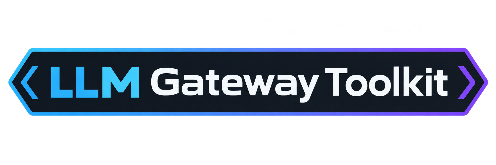
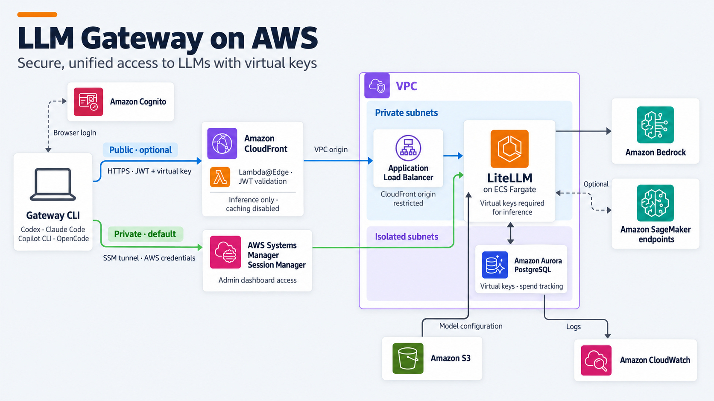

  <picture>
    
  </picture>

  Run your company's AI coding assistants through one central gateway you control, on AWS.

  <a href="#description">Description</a> ·
  <a href="#why-gateways">Why gateways</a> ·
  <a href="./docs/quickstart.md">Quickstart</a> ·
  <a href="#architecture">Architecture</a> ·
  <a href="#components">Explore</a>

 

## Description

Coding agents such as [GitHub Copilot](https://github.com/features/copilot), [Opencode](https://opencode.ai) or [Claude Code](https://www.anthropic.com/claude) talk straight to an external model provider. This toolkit helps you put an AWS-hosted LiteLLM gateway in between.

Developers can keep their tools while you decide which models they can use, monitor what each team spends, and route model requests through AWS. Managed models on Amazon Bedrock and self-hosted models on Amazon SageMaker can run concurrently. The included benchmark harness helps you compare them on your own coding tasks.

> 👉 Start deploying the LLM Gateway Toolkit using our [Quickstart guide](./docs/quickstart.md).

## Why gateways

There are multiple reasons to use an AI gateway, the top ones being:

- **Cost** — Attribute usage to users and teams, set budgets, and compare model costs on real tasks.
- **Sovereignty** — Choose where inference runs through your AWS Region, model, and inference-profile configuration.
- **Evidence** — Measure quality, latency, and token usage before changing which models your team uses.

## Quickstart

🚀 Follow our [Quickstart guide](./docs/quickstart.md) to quickly get up and running on your AWS account.

## Architecture

  <picture>
    
  </picture>

LiteLLM runs on ECS Fargate in private subnets, with Aurora PostgreSQL as a storage backend for virtual keys and spend tracking. It natively integrates with Amazon Bedrock and configured SageMaker endpoints using AWS IAM.

There are two main access methods for running inferences through LiteLLM.

| Access | Connection | Authentication | Requires AWS credentials
| --- | --- | --- | --- |
| **Private — default** | SSM tunnel from developer machine to LiteLLM cluster. | AWS credentials + LiteLLM virtual key. | Yes |
| **Public — optional** | CloudFront over HTTPS, then a VPC origin and internal ALB. | Cognito browser login + LiteLLM virtual key. | No |

> [!NOTE]
> The dashboard and management APIs are accessible through SSM only.

## Components

Each component in this toolkit is described below and provides its own documentation.

| Component | Purpose |
| --- | --- |
| [Gateway on AWS](gateway-cdk/) | CDK deployment of LiteLLM, persistence, and private or authenticated public access. |
| [Gateway CLI](tools/gateway-cli/) | Login, coding-agent launchers, diagnostics, and administration access. |
| [Local gateway](gateway-local/) | LiteLLM and PostgreSQL in Docker Compose for local development. Uses the same model configuration format as the AWS gateway. |
| [Self-hosting](self-hosting-cdk/) | Model-weight staging and a SageMaker vLLM endpoint example for open-weight models. |
| [Prefix-cache hook](prefix-cache-hook/) | Optional Copilot CLI prompt normalization to improve prefix-cache reuse on self-hosted vLLM backends. |
| [Benchmarks](benchmark/) | Run Copilot CLI or OpenCode on your tasks; capture outputs, model exchanges, tokens, cost, latency, and hidden-test results. |

## Related guidance

The [AWS Multi-Provider GenAI Gateway guidance](https://github.com/aws-solutions-library-samples/guidance-for-multi-provider-generative-ai-gateway-on-aws) provides another LiteLLM deployment reference. This toolkit focuses on coding-agent integration, model evaluation, and optional self-hosting.

See the [distribution notes](DISTRIBUTION-NOTES.md) for the comparison.

## Self-hosting on SageMaker

You can serve open-weight models on SageMaker alongside managed Bedrock models through the same LiteLLM gateway.

> Read the [self-hosting guide](docs/self-hosting.md) to compare the options on your coding tasks and connect a SageMaker endpoint.

## Security

See [CONTRIBUTING](CONTRIBUTING.md#security-issue-notifications) for more information.

## License

This library is licensed under the MIT-0 License. See the LICENSE file.
