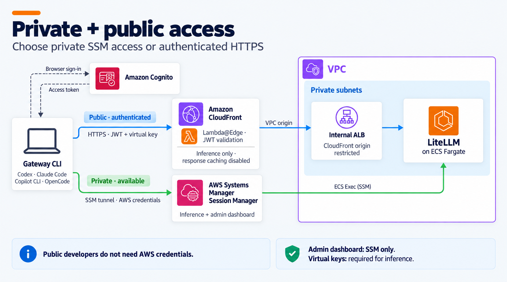
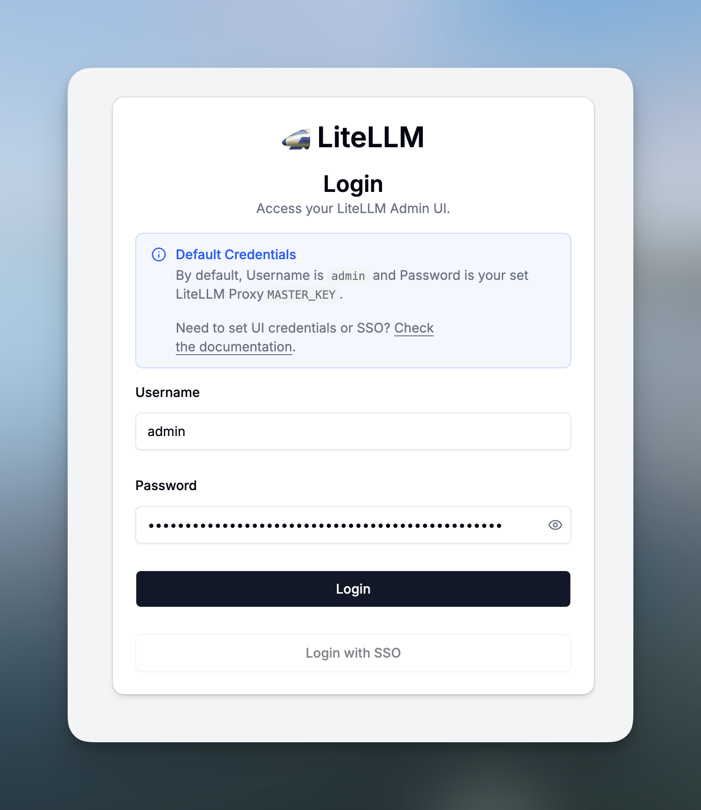
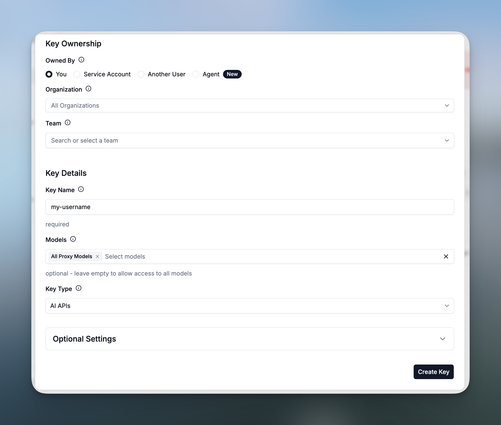

# 🚀 Quickstart

> Deploy a gateway on AWS and connect your first coding agent.

This guide guides you on how to deploy a functional LiteLLM cluster gateway, with a virtual key for model access on your AWS account, and connect your first coding agent.

## Requirements

- Node.js 22.22.2 or later + NPM.
- The AWS CLI, signed in to an account where you can bootstrap CDK, deploy the stack, and start SSM sessions.
- Access to the Bedrock models you want to use.
- A supported coding agent (Claude Code, Codex, OpenCode, GitHub Copilot).

## Deploy the gateway

From the repository root, set the deployment Region, install the CDK dependencies, and bootstrap CDK. Public access also needs `us-east-1`, where CloudFront runs its edge function.

> This is only required the first time you deploy CDK stacks in this account and region.

```sh
export AWS_REGION=eu-west-1
npm ci --prefix gateway-cdk
npm run bootstrap
```

> Set `AWS_REGION` in every terminal where you run `npm run deploy` or `gateway`. Otherwise both use your AWS profile's default Region and won't find the gateway.

Then, choose your preferred deployment option below 👇.

### 1. Private access

Private access is the most secure option as it keeps the gateway enclosed within a private subnet in your VPC. In this option, developers connect through SSM on their machine using their AWS credentials.

> Choose this option if the gateway cannot be publicly exposed on the public Internet, and your developers have access to AWS credentials to connect through SSM.

<br>
<p align="center">
  <picture>
    
  </picture>
</p>

To deploy the gateway with private access, run the following command in the project.

```sh
npm run deploy
```

### 2. Private + public access

This deployment mode combines a private access to the LiteLLM gateway, and additionally exposes the LiteLLM gateway through a public-facing, but authenticated, CloudFront distribution, backed by AWS Cognito for user authentication.

> Choose this option if you want both private access through SSM and public access through a browser with Cognito authentication for your developers, or tools, that do not inherit AWS credentials.

<br>
<p align="center">
  <picture>
    
  </picture>
</p>
<br>

To deploy the gateway with both private and public access, run the following command in the project.

```sh
PUBLIC_ACCESS_ENABLED=true npm run deploy
```

At the end of the deployment, AWS CDK prints the stack outputs, keep these outputs for the next steps.

## Install the Gateway CLI

> The Gateway CLI is a handy CLI tool part of this toolkit, allowing you to manage and interact with the LiteLLM gateway efficiently once it is deployed.

To install it, run the following command from the repository root.

```bash
npm run install-gateway-cli
```

This will create a `gateway` command that you can use to interact with the LiteLLM gateway.

```bash
gateway --help
```

## Create your first virtual key

A virtual key in LiteLLM controls model access and identifies usage of clients making requests to the gateway. Both connection modes require a virtual key to be created to access the gateway through a coding agent.

> For security reasons, the LiteLLM admin dashboard is only accessible through the private SSM tunnel using your AWS credentials, and cannot be accessed directly over the CloudFront distribution.

First, retrieve the LiteLLM administrator password that was automatically created during deployment from AWS Secrets Manager.

```bash
aws secretsmanager get-secret-value \
  --region eu-west-1 \
  --secret-id "$(aws cloudformation describe-stacks \
    --stack-name LlmGatewayToolkit-Gateway \
    --region eu-west-1 \
    --query 'Stacks[0].Outputs[?OutputKey==`MasterKeySecretArn`].OutputValue | [0]' \
    --output text)" \
  --query SecretString \
  --output text
```

Next, we'll use the Gateway CLI to access the LiteLLM administration dashboard automatically.

To do so, simply run the `admin` command to launch the dashboard.

```sh
gateway admin
```

Once the LiteLLM administration dashboard is launched, enter `admin` as the username and the retrieved secret value as the password.

<br>
<p align="center">
  <picture>
    
  </picture>
</p>
<br>

### Create a Virtual Key

Under **Virtual Keys** in the LiteLLM dashboard, choose **Create New Key** and assign it a name and a set of models you want it to have access to.

<br>
<p align="center">
  <picture>
    
  </picture>
</p>
<br>

> You can also set a budget and expiration for the key.

Copy the generated virtual key, you will need it in the next sections.

## Connect to the Gateway

Depending on whether you want to run inferences through your coding agents via the SSM private endpoint, or through the public CloudFront endpoint, follow the appropriate instructions below.

| | [Private Access](variants/private.md) | [Public Access](variants/public.md) |
|---|---|---|
| **Method** | 🟧 SSM | 🟪 CloudFront |
| **Best for** | For teams with direct access to the AWS account, and requiring highly secured setups. | Development teams needing public access, and not having direct access to the AWS account. |
| **How-To** | [Documentation](variants/private.md) | [Documentation](variants/public.md) |

## Access the LiteLLM Dashboard

To access the LiteLLM administration dashboard at any time, run the following command.

> Access to the LiteLLM administration dashboard always goes through the private SSM access for security reasons.

```sh
gateway admin
```

Enter `admin` as the username and the retrieved secret value as the password.

## Troubleshooting

If you encounter issues, or you want to check whether your Gateway CLI is properly configured, run the following command.

```sh
gateway doctor
```

## Clean up

To remove the stack, run the following command.

```sh
npm run destroy
```

Access-log buckets remain in your account; their log objects expire after seven days.

> [!WARNING]
> A teardown deletes the Aurora database, virtual keys, spend history, and generated secrets. The destroy script runs without a confirmation prompt.
