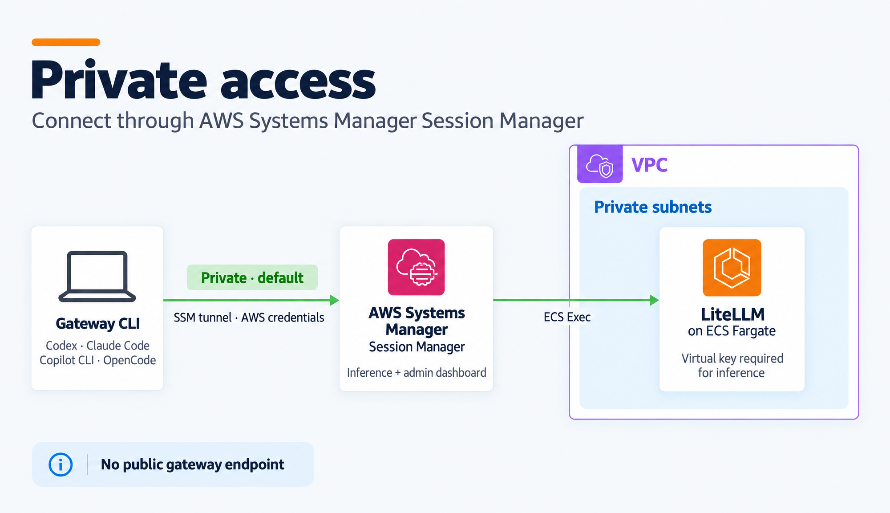
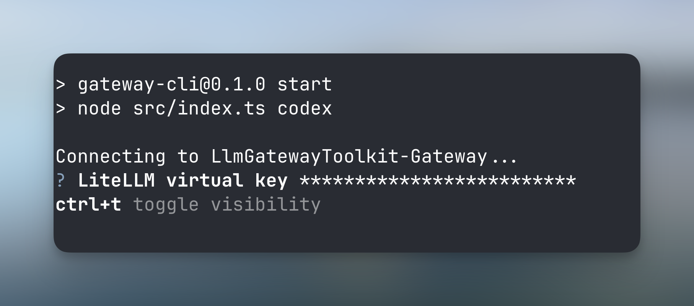

## Private Access

To connect to the LiteLLM gateway using the private endpoint, we will leverage the Gateway CLI to elegantly wrap your coding agent to inject the necessary authentication and connection settings automatically.

> Note that for private access, you need to have AWS credentials configured on your machine.

<br>
<p align="center">
  <picture>
    
  </picture>
</p>
<br>

### Confirming Your Virtual Key

You will be asked for your LiteLLM virtual key when connecting through the private endpoint for the first time. Simply paste it into the prompt.

> The CLI saves the first key you paste and reuses it. To switch to another key, run `gateway logout`; the next command asks for a key again.

<br>
<p align="center">
  <picture>
    
  </picture>
</p>
<br>

### Codex

```bash
gateway codex
```

### Claude Code

```bash
gateway claude
```

### OpenCode

```bash
gateway opencode
```

### GitHub Copilot CLI

```bash
gateway copilot
```

### Setting the Model

You can set the model to use by default using the `--model` flag with the Gateway CLI commands. For example with Codex:

```bash
gateway codex --model gpt-6.1-sol
```

### Setting the Region

You can set the AWS region to use by default using the `--region` flag with the Gateway CLI commands. For example with Codex:

```bash
gateway codex --region us-west-1
```
