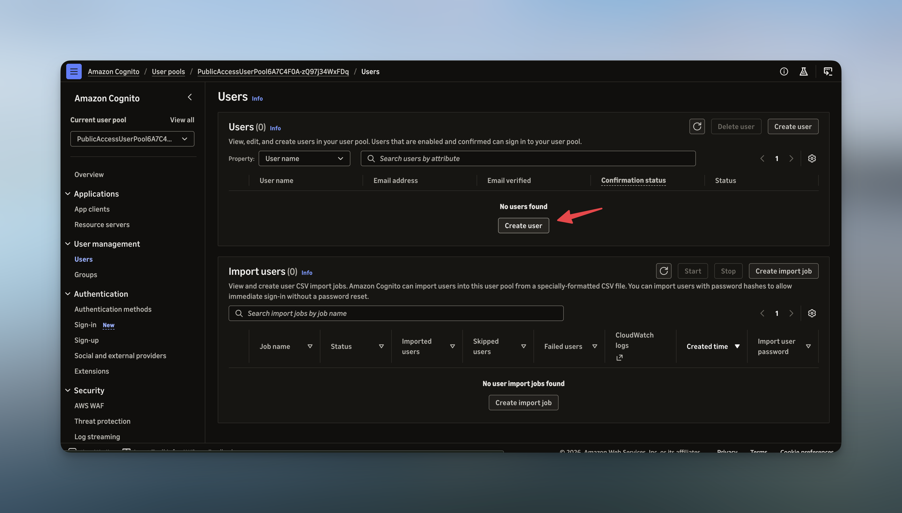

## Public Access

Use the Gateway CLI to sign in with Amazon Cognito and connect your coding agent to the public CloudFront endpoint. Cognito verifies your identity; your LiteLLM virtual key controls model access and records usage.

> For public access, you need the gateway URL, and the LiteLLM virtual key gathered during the deployment in previous step. Developers do not need AWS credentials.

<br>
<p align="center">
  <picture>
    
  </picture>
</p>

### Creating a Cognito User

To create a new Cognito user for a developer, follow these steps:

1. Open the **Amazon Cognito** console in the deployment Region and select the pool matching `UserPoolId`.
2. Choose **Users → Create a user** and create a new user.

<br>
<p align="center">
  <picture>
    
  </picture>
</p>

### Signing In

Start the login flow from your terminal:

```bash
gateway login
```

Enter the `GatewayUrl` from the deployment outputs The CLI opens the Cognito sign-in page in your browser.

On your first sign-in, use the temporary password from your invitation and set a new password.

> MFA is off to keep the sample simple. For production, require it on the user pool (`mfa: cognito.Mfa.REQUIRED` with TOTP in `gateway-cdk/lib/constructs/public-access/index.ts`).

### Confirming Your Virtual Key

You will be asked for your LiteLLM virtual key when connecting through the public endpoint for the first time. Simply paste it into the prompt.

> The CLI saves the key you paste and reuses it. To switch to another key, run `gateway logout`, then `gateway login` again; it asks for a key.

<br>
<p align="center">
  <picture>
    
  </picture>
</p>
<br>

### Codex

```bash
gateway codex
```

### Claude Code

```bash
gateway claude
```

### OpenCode

```bash
gateway opencode
```

### GitHub Copilot CLI

```bash
gateway copilot
```

### Setting the Model

Use `--model` to choose a model configured in LiteLLM and allowed by your virtual key. For example with Codex:

```bash
gateway codex --model gpt-6.1-sol
```
