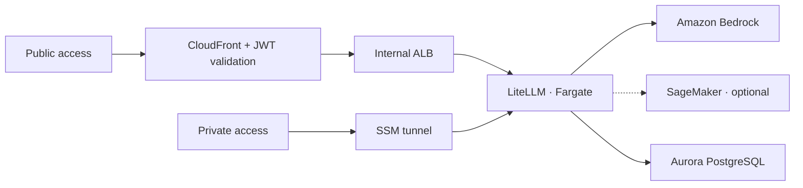

# Gateway on AWS

> A shared model endpoint for your team's coding agents.

This CDK project deploys **LiteLLM on AWS Fargate**, backed by **Aurora PostgreSQL** for virtual keys and spend tracking. It routes requests to **Amazon Bedrock** and optional **Amazon SageMaker endpoints**, using the gateway's IAM role.

[Architecture](#architecture) · [Access](#access) · [Configuration](#configuration) · [Development](#development)

## Architecture



Fargate tasks run in private subnets, with outbound access through a NAT gateway. Aurora runs in isolated subnets. Public access reaches the internal ALB through a CloudFront VPC origin.

## Access

| Mode | Connection | Required credentials |
| --- | --- | --- |
| **Private — default** | SSM tunnel directly to an ECS task. | AWS credentials and a LiteLLM virtual key. |
| **Public — optional** | HTTPS through CloudFront, with Cognito sign-in. | A Cognito account and a LiteLLM virtual key. No AWS credentials needed. |

Set `PUBLIC_ACCESS_ENABLED=true` to include public access when deploying or updating the stack. `npm run destroy` includes both stacks automatically. It uses AWS-provided domains; no custom domain is required.

[Gateway CLI](../tools/gateway-cli/) handles login, token refresh, and tunnels for **Claude Code, Codex, GitHub Copilot CLI, and OpenCode**. Developers keep their agents and work in their usual project directories.

> [!NOTE]
> The dashboard and management APIs are accessible through SSM only, using `gateway admin` or `gateway tunnel`. Public access accepts inference requests, with JWT validation on every request and response caching disabled.

## Configuration

The model catalogue lives in [`config/litellm-config.yaml`](config/litellm-config.yaml). CDK uploads it to S3 and rolls the service when it changes. LiteLLM loads the file at startup, so catalogue updates need a deployment but no container rebuild.

Keep model entries aligned with [`gateway-local/config.yaml`](../gateway-local/config.yaml), and check their Region and inference-profile settings.

| Integration | Where to start |
| --- | --- |
| **SageMaker** | [Self-hosting example](../self-hosting-cdk/). Add the endpoint route to the catalogue and its ARN to `sagemakerEndpointArns` in [`bin/gateway.ts`](bin/gateway.ts). |
| **Prefix caching** | [Optional hook](../prefix-cache-hook/) for Copilot with self-hosted engines. Requires a custom gateway image containing the hook. |

The stack composes two components: [`GatewayConstruct`](lib/constructs/gateway.ts) owns the service and persistence; [`PublicAccessConstruct`](lib/constructs/public-access/index.ts) owns Cognito, CloudFront, and the ALB.

## Development

Use **Node.js 22.22.2 or later**. From this directory:

```sh
npm ci
npm run build
npm run lint
npm run synth
```

Compiled JavaScript goes to `dist/`; CDK runs the TypeScript sources through `tsx`. Synthesis runs CDK Nag, with documented exceptions in [`bin/cdk-nag.ts`](bin/cdk-nag.ts). Public synthesis uses `PUBLIC_ACCESS_ENABLED=true`.

> [!IMPORTANT]
> This sample uses `RemovalPolicy.DESTROY`. Deleting the gateway stack deletes its database and generated secrets. Compute, database, and networking resources incur charges while deployed. Review retention and availability requirements before production use.
