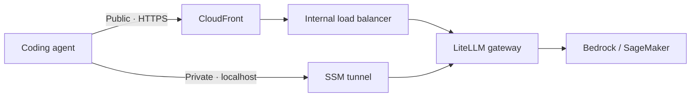

# Gateway CLI

> Use your coding agent with a shared AI gateway on AWS.

Gateway CLI connects **Claude Code, Codex, GitHub Copilot CLI, and OpenCode** on your computer to this sample's [LiteLLM gateway](../../gateway-cdk/). The gateway routes model requests to Amazon Bedrock or configured Amazon SageMaker endpoints.

The CLI handles sign-in, supplies the agent's gateway settings, refreshes authentication tokens, and manages private connections. Your agent still runs locally, in your project directory.

[How it works](#how-it-works) · [Getting started](#getting-started) · [Everyday commands](#everyday-commands) · [Troubleshooting](#troubleshooting)

## How it works

There are two ways to reach the gateway. Choose the one your administrator has enabled and given you access to.

| Mode | Connection | What you need |
| --- | --- | --- |
| **Public** | Authenticated HTTPS through Amazon CloudFront. The CLI opens an Amazon Cognito sign-in page in your browser. | A gateway URL, a Cognito account, and a virtual key. AWS credentials are not required. |
| **Private** | A tunnel through AWS Systems Manager Session Manager (**SSM**) to the gateway's private ECS service. A public gateway URL is not required. | AWS credentials with permission to discover the gateway and start SSM sessions, plus a virtual key. |

Both modes require a **LiteLLM virtual key**, supplied by your administrator. This key identifies your gateway usage and controls which models you can access. It is separate from your browser sign-in or AWS credentials.



> [!NOTE]
> Public access is for model requests. The administration dashboard and management APIs are accessible only through SSM.

## Getting started

Before starting, you need:

- [Node.js](https://nodejs.org/en/download) **22.22.2 or later**, with npm.
- One of the [supported coding agents](#3-run-an-agent), installed and available on your `PATH`.
- A deployed gateway. Ask your administrator for access, or start with the [gateway infrastructure](../../gateway-cdk/).

### 1. Install the CLI

From the root of your local clone:

```sh
npm run install-gateway-cli
```

This installs dependencies, builds the CLI, and makes the `gateway` command available in your terminal. Keep the clone in place: the command links to its built files.

<details>
<summary>Platform requirements</summary>

The CLI uses your operating system's credential store. On Linux, you need an unlocked Secret Service provider, such as GNOME Keyring, and system CA certificates (`ca-certificates`).

Installation downloads the Session Manager plugin for your platform and reuses a verified copy on subsequent installs. Supported platforms are **macOS ARM64**, **Linux x64/ARM64**, and **Windows x64**. A separate plugin installation or AWS CLI installation is not required to open tunnels.

</details>

### 2. Connect to your gateway

**With a browser — public mode**

```sh
gateway login
```

Enter the gateway URL when prompted, complete the Cognito login in your browser, then paste your virtual key in the terminal **without a `Bearer ` prefix**. The CLI verifies access before saving your sign-in.

**With AWS credentials — private mode**

Sign in to AWS using your organization's usual credential setup, then start your agent directly:

```sh
gateway codex --transport ssm --model gpt-6.1-sol
```

The CLI discovers the `LlmGatewayToolkit-Gateway` stack using your AWS configuration and prompts for a virtual key if needed. It verifies the key, saves the private connection settings, and starts your agent. No `gateway login` is required.

If you administer a new gateway, run `gateway admin` first, sign in to LiteLLM, and create a virtual key.

<details>
<summary>Use a different AWS profile, region, or stack</summary>

Supply only the settings you need to override:

```sh
gateway codex --transport ssm --profile demo --region eu-west-1 --stack LlmGatewayToolkit-Gateway
```

These settings are saved after the private connection is verified. `admin` and `tunnel` accept the same AWS options.

</details>

Public login makes public access the default. Without saved settings, agents use SSM. Explicit gateway or AWS options select their corresponding transport; use `--transport` to choose directly. There is no transport-selection prompt.

### 3. Run an agent

Check the connection:

```sh
gateway doctor
```

Then, from the project directory you want to work in, start your installed agent. Agent names below link to their installation instructions.

| Agent | Start through the gateway |
| --- | --- |
| [Claude Code](https://code.claude.com/docs/en/quickstart) | `gateway claude` |
| [Codex](https://developers.openai.com/codex/cli) | `gateway codex --model gpt-6.1-sol` |
| [GitHub Copilot CLI](https://docs.github.com/en/copilot/how-tos/copilot-cli/set-up-copilot-cli/install-copilot-cli) | `gateway copilot --model gpt-6.1-sol` |
| [OpenCode](https://opencode.ai/docs/) | `gateway opencode` |

`--model` selects a model alias configured in LiteLLM and allowed by your key. The default is `claude-sonnet`.

Put gateway options before `--` and agent arguments after it:

```sh
gateway codex --model gpt-6.1-sol -- exec "Explain this project"
```

Public authentication tokens refresh automatically. In private mode, each agent gets a tunnel that closes when the agent exits.

## Everyday commands

| Command | Purpose |
| --- | --- |
| `gateway login` | Sign in to a public gateway through Cognito. |
| `gateway doctor --agent codex` | Check gateway access and the selected agent. |
| `gateway admin` | Open the LiteLLM administration dashboard through SSM. |
| `gateway tunnel --port 4000` | Keep a private tunnel open for another API client. |
| `gateway logout` | Remove saved gateway credentials and connection settings. |

Use `gateway --help` or `gateway <command> --help` for available options.

> [!IMPORTANT]
> `admin` and `tunnel` use your AWS credentials directly and do not require `gateway login`. The dashboard requires its own LiteLLM login. Keep the terminal open while using either command; press **Ctrl+C** to close the tunnel.

<details>
<summary>Connect another API client through a tunnel</summary>

Run `gateway tunnel --port 4000` and configure your client with:

```text
Base URL: http://localhost:4000/v1
Header:   x-litellm-api-key: Bearer <virtual-key>
```

Use a virtual key supplied by your administrator.

</details>

## Troubleshooting

Start with `gateway doctor`. It checks the selected connection, saved credentials, model access, and installed agents. It does **not run model inference**. Failed checks include a recovery action and return exit code `1`.

Use `--agent codex` to require that agent. Without `--agent`, unavailable agents are skipped. Private diagnostics close their temporary tunnel before returning; public diagnostics can refresh your saved sign-in.

| If you see… | Next step |
| --- | --- |
| Missing or expired public sign-in | Run `gateway login`. |
| No virtual key saved for the private gateway | Start your agent with `--transport ssm` and enter a key when prompted. |
| AWS discovery or SSM access failed | Check your AWS sign-in, selected region and stack, and session permissions. |
| Agent not installed | Install the agent and make its executable available on `PATH`. |
| No models available to your key | Ask your administrator to grant the key access to a model. |

<details>
<summary>Where settings and credentials are stored</summary>

- Connection preferences live in `~/.llm-gateway/config.json`.
- Public sign-in credentials are encrypted locally; their encryption key is held in the OS credential store.
- Private virtual keys are held in the OS credential store, separately for each deployment.

`gateway logout` attempts to revoke the Cognito refresh token, removes the public session and configured private virtual key, and clears connection settings. Public access requires login again; private agents ask for a key again. Your AWS credentials, administration access, and already-running sessions or tunnels are unaffected.

</details>
